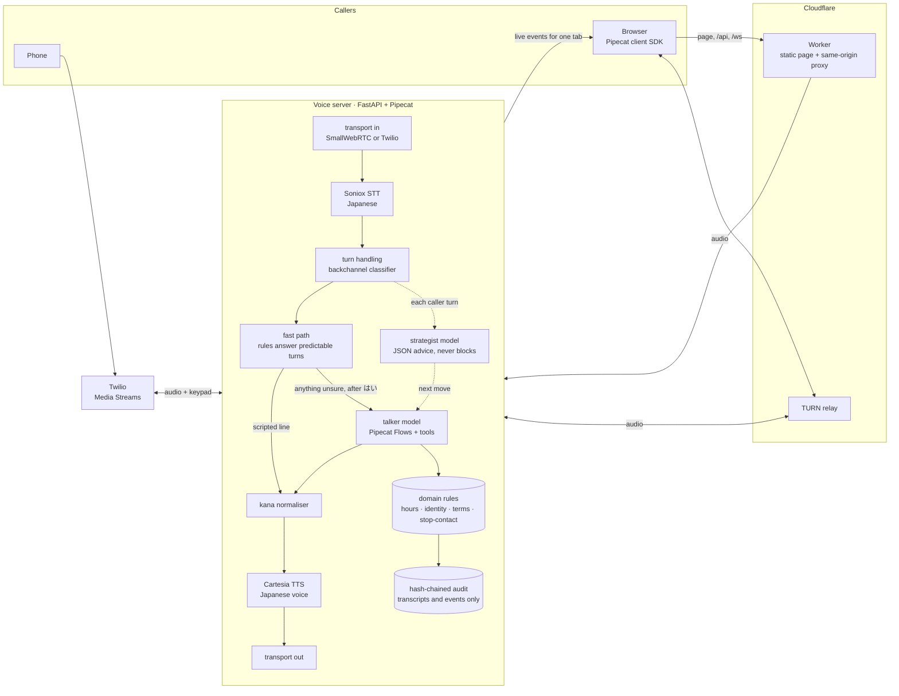

# Call Kenji

A Japanese debt-collection voice agent you can phone, with a live view of its reasoning during
**your own** call.

Kenji works for Minato Servicer (みなと債権回収), a fictional debt servicer. You play the
customer, 佐藤ゆうき (Yuki Sato), who is ¥35,000 behind. Call from the browser or by phone, and the
page shows what Kenji hears, how he decides when you talk over him, what a second model advises
him to do next, which safeguards hold, and how fast he answers. When you hang up you get the
outcome, the SMS he would send (it is never sent) and a hash-chained audit record.

Everything about the account and the company is invented. The page asks you not to share real
personal details.

## The 60-second pitch

Voice agents for collections live or die on three things a demo usually hides: **turn-taking**,
**compliance** and **latency**. Call Kenji shows all three on screen while it runs.

- **Turn-taking in Japanese.** Callers say はい and ええ constantly while the other person talks.
  Word-count interruption rules split on spaces, and Japanese has none. Kenji counts characters,
  knows the aizuchi lexicon, and is stricter while reading the agreement back. はい keeps him
  going; ちょっと待ってください stops him. A pause is not the end of a turn either: Soniox judges
  the end from the words and intonation, and a phrase left on a particle, like 「生年月日は、」,
  is held open so the date that follows joins the same turn.
- **Compliance as code.** Calling hours (08:00 to 21:00 Japan time), an identity gate before
  any account detail, repayment terms (at least ¥5,000 a month, at most 6 payments, first one
  within 45 days) and stop-contact are pure, fully tested functions. The model can only reach them
  through tools, so it cannot promise ¥3,000 a month however persuasive the caller is.
- **A strategist that never blocks.** After each caller turn a second model writes structured
  advice: identity, situation, ability to pay, offers and next move. The next move reaches the
  talker on the following turn, so the conversation never waits for it.
- **Latency you can see.** Every turn is split into end-of-turn detection, the model's first
  token and the first audio, against a 1,500 ms budget, with p50 and p95. Kenji does not wait
  on the model for turns the rules can answer: identity, an offer, a plain yes to a plan or to
  the read-back. Every other turn opens with an instant 「はい、」 while the model works. On real
  voice calls the caller hears Kenji after about 0.7 s (p50); Muse Spark's own answer still
  takes 2 to 6 s on the turns it handles.

## Architecture



The Python code is hexagonal:

- **`domain/`** is pure and has no I/O: compliance, terms, identity, kana readings, turn decisions,
  latency and the audit chain. It has 100% line and branch coverage.
- **`app/`** orchestrates: Pipecat Flows nodes, the tools, the strategist, the turn strategy, the
  live event hub and the guardrails at the door.
- **`adapters/`** holds the vendors behind small `Protocol` ports: Soniox, Cartesia,
  OpenAI-compatible models, Twilio, Cloudflare TURN, storage and an optional ONNX classifier.
- **`web/`** is the React page, built only from the tokens in `docs/DESIGN.md`.

Every Japanese line Kenji says, and every prompt the models see, is in `content/script_ja.yaml`,
so a native speaker can review one file.

## What is real and what is simulated

| Real | Simulated or limited |
|---|---|
| Speech recognition (Soniox), speech (Cartesia), the language models | The servicer, the debtor, the account and the debt are fictional |
| The phone number and the browser call | There is no human to hand over to: Kenji writes the handoff record instead |
| Turn-taking, tools, the guardrails and the audit chain run on every call | The SMS is a preview and is never sent |
| The live view shows your call and only your call | `?demo=1` replays a recorded call with no backend |
| Transcripts and events are kept for 30 days, then deleted | Audio is never stored |

The language model runs on Meta's Muse Spark contributor tier. Meta may use that traffic to
improve its models, which is one more reason the page asks callers not to share real details.

## Monthly cost

At 60 phone minutes and 30 browser minutes a day the total is about **$69 a month**: hosting is
about $12, and the rest is pay-per-use speech, telephony and model calls.

The voice server runs on one always-warm Cloud Run instance rather than Pipecat Cloud. One
service holds everything the guardrails need: the signed Twilio webhook, the daily counters, the
WebRTC offers and the private viewer feed. A warm Cloud Run instance costs about $12 a month,
against about $48.60 for a warm Pipecat Cloud agent. Cloud Run takes no inbound UDP, so browser
audio relays through Cloudflare TURN, which is free at this volume.

The guardrails cap usage:

- 5 minutes a call;
- 60 phone minutes and 60 browser minutes a day;
- 3 calls a day per caller;
- a $20 budget alert.

The itemised table and the full hosting decision are in [docs/DEPLOY.md](docs/DEPLOY.md).

## Run it

You need [uv](https://docs.astral.sh/uv/) 0.12.22, Node 22.12 or newer, pnpm 12, and GNU Make.
On Windows, install Make with `winget install ezwinports.make` or use WSL. With an older pnpm,
pass `PNPM="npx -y pnpm@12.8.1"` to each `make` command.

```bash
git clone https://github.com/rushabhT3/call-kenji.git && cd call-kenji
make install
make test     # domain, app, conversation and server tests, plus web unit tests; no keys needed
make e2e      # Playwright against the demo replay, with the backend blocked
make lint
```

**The demo replay needs no keys:**

```bash
cd web && pnpm dev    # then open http://localhost:5173/?demo=1
```

**Talk to Kenji in your browser:**

1. Copy `.env.example` to `.env`.
2. Fill in `LLM_API_KEY`, `SONIOX_API_KEY` and `CARTESIA_API_KEY`. To use a provider other than
   OpenAI, also set `LLM_BASE_URL` and the three model names. The Muse Spark settings are in
   `.env.example`.
3. Run `make dev` and open http://localhost:5173.
4. Press **Call from browser**.

The real-model smoke run drives the five test conversations through your provider:

```bash
uv run pytest -m real_llm
```

The voice check calls Kenji over WebRTC with a synthetic caller, a second Cartesia voice, so speech
recognition, both models and speech synthesis all run for real. It costs a few cents a run:

```bash
uv run python scripts/voice_check.py    # or name some of: promise spouse handoff
```

**Try the phone line** without buying a number. A browser softphone calls Kenji through
Twilio's network, so the signed webhook, the Media Stream at 8 kHz and keypad linking all run
for real. It costs about $0.008 a minute of Twilio credit:

1. In the Twilio Console, create an API key (Standard), then a TwiML App with any voice URL.
   The script below points it at your machine each time it runs.
2. In `.env`, set `TWILIO_ACCOUNT_SID`, `TWILIO_AUTH_TOKEN`, `TWILIO_API_KEY_SID`,
   `TWILIO_API_KEY_SECRET`, `TWILIO_TWIML_APP_SID` and `PUBLIC_BASE_URL=http://127.0.0.1:7860`.
3. Install [cloudflared][cloudflared] for a free quick tunnel. No Cloudflare account is needed.
4. Run `uv run python scripts/phone_dev.py` and, in another terminal, `cd web && pnpm dev`.
5. Open http://localhost:5173 for the live view, then http://127.0.0.1:7860/dev/softphone.
   Press **Call Kenji**, and type the page's four-digit code on the keypad when he asks.

The softphone only answers a browser on the same machine, never a request through the tunnel.
Kenji answers between 08:00 and 21:00 Japan time, as on the real line.

The phone line and deployment are covered step by step in [docs/DEPLOY.md](docs/DEPLOY.md).

[cloudflared]: https://developers.cloudflare.com/cloudflare-one/connections/connect-networks/downloads/

## Where to look

| Question | File |
|---|---|
| Is the ¥3,000 a month offer really blocked? | `src/kenji/domain/terms.py`, `tests/domain/test_terms.py` |
| How does はい differ from ちょっと待って? | `src/kenji/domain/turn.py`, `src/kenji/app/turns.py` |
| How does the strategist avoid blocking the talker? | `src/kenji/app/strategist.py` |
| How is 3万5千円 read aloud? | `src/kenji/domain/kana.py` |
| Why can only my tab see my call? | `src/kenji/app/hub.py`, `src/kenji/app/dtmf.py`, `src/kenji/phone_routes.py` |
| Decisions the brief left open | `docs/DECISIONS.md` |
| Pinned versions and their docs | `docs/VERSIONS.md` |
| The design system | `docs/DESIGN.md`, `docs/DESIGN-REVIEW.md` |

## A 75-second screen recording

1. **0:00–0:10, landing page.** "This is Kenji, a Japanese collections agent. I play Yuki Sato,
   who owes ¥35,000." Point at the role card and the call panel.
2. **0:10–0:20, call from the browser.** Kenji says he is an AI, that this is a demo, and how the
   call is kept. The Compliance card turns green row by row.
3. **0:20–0:35, identity.** Give the name and the 平成 birthday. Show the identity gate passing,
   then Kenji stating the balance only after that.
4. **0:35–0:50, negotiation.** Offer ¥3,000. "Offer inside terms" goes BLOCKED, and the
   Strategist suggests ¥6,000 × 5 then ¥5,000. Accept.
5. **0:50–1:00, read-back.** Say はい while Kenji reads the agreement. The Turn card shows it was
   aizuchi, and he keeps going.
6. **1:00–1:15, after the call.** Show the outcome, the SMS preview marked NOT SENT, and the audit
   record with HASH CHAIN VERIFIED. End on the Latency card's p50.

## Launch post

> I built Call Kenji: a Japanese debt-collection voice agent you can actually call, with a live
> X-ray of its reasoning that only you can see.
>
> Play Yuki Sato, ¥35,000 behind, and try to talk Kenji into ¥3,000 a month. Say はい while he
> reads the agreement back and watch him decide it was aizuchi, not an interruption. Pretend to be
> Yuki's spouse and see that he says nothing about the debt.
>
> Built with Pipecat, Pipecat Flows, Soniox, Cartesia, Twilio and Cloudflare. The company and the
> debt are fictional, transcripts are deleted after 30 days, audio is never stored, and the SMS is
> never sent. The language model runs on Meta's Muse Spark contributor tier, which may use the
> conversation to improve its models, so please don't share real details.
>
> Call from the browser or by phone: <link>
